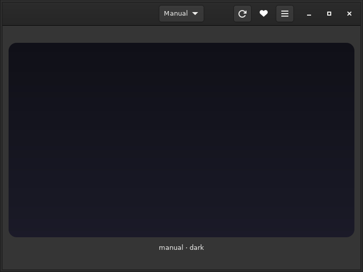
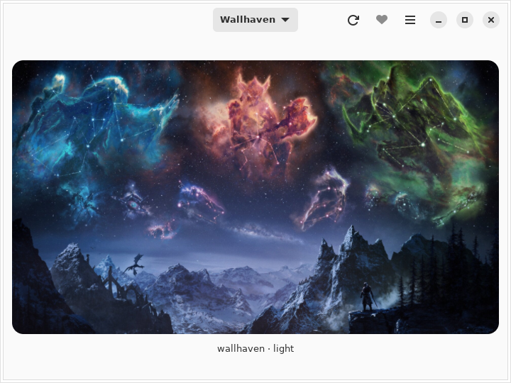

<p align="center">
  
</p>

# Valhalla

A minimal wallpaper application for Linux desktops, inspired by
[Damask](https://gitlab.gnome.org/subpop/damask), written in Rust with GTK 4 and
libadwaita.

Valhalla picks wallpapers from online sources and — most importantly — always
matches them to your desktop's light/dark preference, so dark mode never gets a
blinding white wallpaper.

## Screenshots

<p align="center">
  
  
</p>

## Features

- **Theme-aware selection**: wallpapers are analyzed (average brightness) and
  matched against the desktop color scheme; selection re-runs immediately when
  you switch light/dark mode
- **Sources**: Wallhaven and Unsplash
- **Filters**: tags, categories, purity (SFW/sketchy/NSFW), resolution, aspect
  ratio, sorting
- **API keys** stored in the GNOME Keyring (required for NSFW on Wallhaven and
  for any Unsplash usage)
- **Automatic refresh** on an interval, on theme change, or manually
- **Runs everywhere** the XDG desktop portal does (GNOME, KDE, ...), with a
  direct GSettings fallback on GNOME; sets `picture-uri` and `picture-uri-dark`
  independently so a manual theme flip never shows a mismatched wallpaper
- **Headless daemon** (`valhalla --daemon`) for refreshing without a window,
  with an opt-in "Start at login" switch (XDG autostart entry)

## Building

Development happens in a distrobox/toolbox container (or any distro with the
GNOME stack):

```sh
distrobox enter valhalla
cd ~/Projects/valhalla
cargo build --release
```

Requirements (Fedora, run inside the container):

```sh
sudo dnf install -y rust cargo rustfmt clippy gcc pkgconf-pkg-config \
    gtk4-devel libadwaita-devel libsecret-devel glib2-devel blueprint-compiler git
```

## Flatpak

The app is distributed through a self-hosted Flatpak repository: every
release is built automatically in CI from
[`flatpak/io.github.tunix.valhalla.json`](flatpak/io.github.tunix.valhalla.json)
on the GNOME 49 runtime and published (GPG-signed) to the `tunix` remote.

**Install (recommended):** add the remote once, then install like any
Flathub app. Future updates arrive via `flatpak update`.

```sh
flatpak remote-add --if-not-exists tunix \
    https://alperkan.at/flatpak/tunix.flatpakrepo
flatpak install tunix io.github.tunix.valhalla
```

Or the single-command version, which adds the remote and installs in
one step via the signed ref file:

```sh
flatpak install \
    https://alperkan.at/flatpak/io.github.tunix.valhalla.flatpakref
```

**Offline / airgapped:** every release also ships ready-to-install
`.flatpak` bundles (x86_64 and aarch64). Grab one from the
[releases page](https://github.com/tunix/valhalla/releases) and install:

```sh
flatpak install ./valhalla-<tag>-x86_64.flatpak
```

The bundle references its runtime, so the GNOME 49 platform is pulled
from Flathub automatically on first install. Note that bundles are
frozen at their tag: they do not receive updates through
`flatpak update` — switch to the remote install above for updates.

To build the bundle locally instead:

```sh
# regenerate the vendored-crate source list from Cargo.lock
python3 flatpak/flatpak-cargo-generator.py Cargo.lock \
    -o flatpak/generated-sources.json

# build (offers to install the GNOME 49 Sdk and the rust-stable
# extension on first run)
flatpak-builder --force-clean --user --default-branch=stable \
    --repo=flatpak-repo flatpak-build flatpak/io.github.tunix.valhalla.json

# optional: single-file bundle to share or install
flatpak build-bundle \
    --runtime-repo=https://flathub.org/repo/flathub.flatpakrepo \
    flatpak-repo valhalla.flatpak io.github.tunix.valhalla stable
flatpak install ./valhalla.flatpak
```

A Flathub submission is planned on top of the same manifest.

## Running

```sh
cargo run            # GUI
cargo run -- --daemon  # headless wallpaper refresh service
```

To refresh at boot/login without the window, enable **Start at login** in
Preferences — Valhalla writes a desktop autostart entry that launches
`valhalla --daemon`. The entry also shows up in the desktop's own
"Startup Applications" list, so it can be toggled off from either side.

## Settings

Stored in GSettings (`gsettings list-recursively io.github.tunix.valhalla`),
API keys in the Secret Service (GNOME Keyring).

## License

GPL-3.0